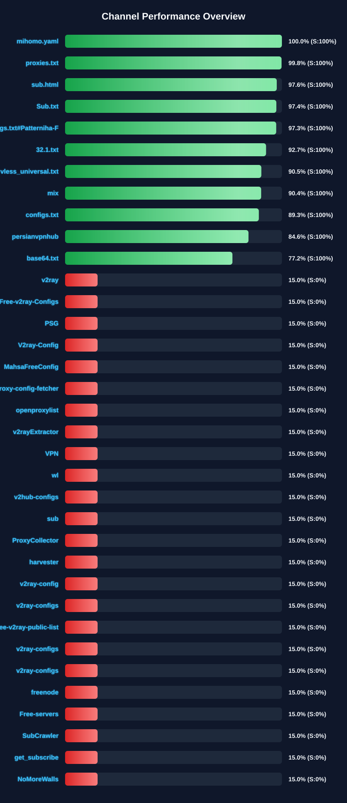

[](https://github.com/javadz501/SUB0/stargazers)
[](https://github.com/javadz501/SUB0/network/members)
[](https://github.com/javadz501/SUB0/issues)
[](https://github.com/javadz501/SUB0/blob/main/LICENSE)
[](https://github.com/javadz501/SUB0/commits/main)

<div dir="ltr">

# SUB0 – Free Proxy Configuration Collector

[**🇺🇸 English**](README.md) | [**🇮🇷 فارسی**](README_FA.md) | [**🇨🇳 中文**](README_CN.md) | [**🇷🇺 Русский**](README_RU.md)

SUB0 是一个自动化代理配置管理系统，可从多个来源收集、验证、测试、丰富和过滤代理配置。项目通过并行处理、多阶段连接测试、地理位置信息和安全过滤机制，为不同代理客户端生成多种格式的配置文件。

## 🌐 配置访问

项目生成的配置文件可直接通过 GitHub 仓库访问。

### 订阅与配置文件

| 输出类型 | 格式 | 链接 |
|---|---|---|
| 原始配置 | TXT | [查看](https://raw.githubusercontent.com/javadz501/SUB0/main/configs/proxy_configs.txt) |
| Xray 测试通过的配置 | TXT | [查看](https://raw.githubusercontent.com/javadz501/SUB0/main/configs/proxy_configs_tested.txt) |
| 全部 Sing-box 配置 | JSON | [查看](https://raw.githubusercontent.com/javadz501/SUB0/main/configs/singbox_configs_all.json) |
| Sing-box 测试通过的配置 | JSON | [查看](https://raw.githubusercontent.com/javadz501/SUB0/main/configs/singbox_configs_tested.json) |
| 安全筛选后的 Sing-box 配置 | JSON | [查看](https://raw.githubusercontent.com/javadz501/SUB0/main/configs/singbox_configs_secure.json) |
| 全部 Clash 配置 | YAML | [查看](https://raw.githubusercontent.com/javadz501/SUB0/main/configs/clash_configs_all.yaml) |
| Clash 测试通过的配置 | YAML | [查看](https://raw.githubusercontent.com/javadz501/SUB0/main/configs/clash_configs_tested.yaml) |
| 安全筛选后的 Clash 配置 | YAML | [查看](https://raw.githubusercontent.com/javadz501/SUB0/main/configs/clash_configs_secure.yaml) |

> 以上链接指向仓库中的输出文件。配置数量和内容会随着自动更新而变化。

## 📊 来源性能监控

项目收集已配置来源（Telegram 频道和 URL）的性能数据。性能图表会在自动化工作流运行期间更新。

### 快速概览

<div align="center">
  <a href="assets/channel_stats_chart.svg">
    
  </a>
</div>

### 详细报告

📊 [查看交互式来源性能报告](assets/performance_report.html)

每个来源根据以下四项指标进行评估：

- **可靠性（35%）：** 获取和更新配置的成功率
- **配置质量（25%）：** 有效配置占获取配置总数的比例
- **配置唯一性（25%）：** 唯一配置所占的比例
- **响应时间（15%）：** 来源的响应时间和可用性

根据项目的来源管理逻辑，评分低于 30% 的来源会被自动禁用。

## ✨ 主要功能

### 多协议支持

- **VLESS** — 轻量级代理协议，支持 Reality 和 XTLS Vision
- **VMess** — V2Ray 代理协议
- **Trojan** — 基于 TLS 的代理协议
- **Shadowsocks** — 支持 AEAD 加密方式的加密代理
- **Hysteria2** — 高性能 UDP 代理协议
- **WireGuard** — 现代 VPN 协议；目前仅存在于原始/测试文本输出中，默认禁用。
- **TUIC** — 基于 UDP 的代理协议；目前具有与 WireGuard 类似的限制，默认禁用。

### 高级处理流水线

1. **智能采集**
   - 支持 Telegram 频道、SSCONF 链接和自定义 URL
   - 自动 Base64 解码与格式识别
   - 根据协议、地址、端口和认证信息进行语义去重
   - 仅针对临时性错误（超时、连接问题、HTTP 408、429 和 5xx）重试

2. **地理信息增强**
   - 自动检测服务器地理位置
   - 使用国家旗帜 Emoji 标记
   - 支持多个地理定位 API
   - 主 API 不可用时使用备用机制

3. **按国家分类**
   - 根据服务器所在国家对 Xray 测试通过的配置进行分类
   - 为配置中定义的国家生成独立订阅文件
   - 重用已缓存的地理位置数据，减少不必要的 API 请求
   - 如果某次运行中某个国家没有匹配配置，则保留该国家之前的文件

4. **智能重命名**
   - 根据协议特征生成描述性标签
   - 识别传输类型，例如 WS、GRPC 和 HTTP2
   - 识别 TLS、Reality、XTLS 和 Vision 等安全特征
   - 在名称中加入端口和国家信息

5. **双核心多轮测试系统**
   - 使用 Xray Core 和 Sing-box Core 进行连接测试
   - 每个核心执行多个独立测试轮次
   - 仅保留通过所有指定测试轮次的配置
   - 在不同测试轮次之间轮换目标 URL
   - 在测试前检查目标 URL 的可用性
   - 支持并行处理，并可配置 Worker 数量和 Timeout

6. **安全过滤**
   - 移除不安全的加密方式
   - 检查 TLS/SSL 配置
   - 过滤过时协议和配置
   - 为受支持的格式生成独立安全输出

7. **格式转换**
   - 自动生成 Sing-box JSON 配置
   - 生成支持 Load Balancing 的 Xray 配置
   - 支持 Xray Fragment 配置
   - 生成 Clash/Mihomo YAML 配置
   - 在受支持的输出格式中处理 Reality 和 XTLS Vision

## 🚀 快速开始

### 普通用户

1. 从[配置访问](#-配置访问)部分选择所需配置文件。
2. 复制对应文件链接。
3. 将链接导入支持相应格式的代理客户端。

### 开发者

#### Fork 与自定义

1. Fork 此仓库。
2. 编辑 `settings/user_settings.py`，配置：
   - 来源 URL 和 Telegram 频道
   - 启用的协议
   - 连接测试参数
   - 地理定位 API 优先级
3. 如需自定义 Fragment，可编辑 `settings/fragment_settings.py`。
4. 如需更改拥有独立订阅文件的国家，可编辑 `src/country_splitter.py` 中的 `TARGET_COUNTRIES`。
5. 在 Fork 仓库中启用 GitHub Actions。
6. 自动更新流程将按照定义的计划运行。

#### 本地运行

有关本地安装和运行方式，请查看仓库中提供的安装文件和指南。

| 语言 | 指南 |
|---|---|
| 波斯语 | [波斯语指南](README_WIZARD_FA.md) |
| 英语 | [English Guide](README_WIZARD_EN.md) |
| 中文 | [中文指南](README_WIZARD_CN.md) |
| 俄语 | [Русское руководство](README_WIZARD_RU.md) |

## ⚙️ 配置选项

### `settings/user_settings.py`

主要配置示例：

```python
# Source URLs
SOURCE_URLS = [
    "https://t.me/s/your_channel",
    "https://raw.githubusercontent.com/user/repo/main/configs.txt",
]

# Power Mode
USE_MAXIMUM_POWER = True
SPECIFIC_CONFIG_COUNT = 0

# Protocol Filtering
ENABLED_PROTOCOLS = {
    "wireguard://": False,
    "hysteria2://": True,
    "vless://": True,
    "vmess://": True,
    "ss://": True,
    "trojan://": True,
    "tuic://": False,
}

# Config Age Filtering
MAX_CONFIG_AGE_DAYS = 1

# Xray Testing
ENABLE_XRAY_TESTER = True
XRAY_TESTER_MAX_WORKERS = 24
XRAY_TESTER_TIMEOUT_SECONDS = 5
XRAY_TESTER_ROUNDS = 3
XRAY_TESTER_BATCH_SIZE = 200

XRAY_TESTER_URLS = [
    "https://www.youtube.com/generate_204",
    "https://www.gstatic.com/generate_204",
    "https://cp.cloudflare.com",
]

# Sing-box Testing
ENABLE_SINGBOX_TESTER = True
SINGBOX_TESTER_MAX_WORKERS = 24
SINGBOX_TESTER_TIMEOUT_SECONDS = 5
SINGBOX_TESTER_ROUNDS = 3
SINGBOX_TESTER_BATCH_SIZE = 200

SINGBOX_TESTER_URLS = [
    "https://www.youtube.com/generate_204",
    "https://www.gstatic.com/generate_204",
    "https://cp.cloudflare.com",
]

# Geolocation APIs
LOCATION_APIS = [
    "api.iplocation.net",
    "freeipapi.com",
    "ip-api.com",
    "ipapi.co",
]
```

禁用任意测试器会跳过本次运行中对应的连接测试阶段，并将上一阶段的文件原样传递到后续阶段。

请注意，Sing-box、Clash 和 Xray Secure 输出依赖 Sing-box 测试阶段。禁用该测试器可能降低这些输出的可靠性。

### `settings/fragment_settings.py`

```python
FRAGMENT_ENABLED = True

FRAGMENT_STAGE_1 = {
    "packets": "tlshello",
    "lengths": ["5", "94", "1"],
    "delays": ["0"],
    "max_split": "0",
}

FRAGMENT_STAGE_2_ENABLED = True

FRAGMENT_STAGE_2 = {
    "packets": "1-1",
    "lengths": ["109", "1"],
    "delays": ["1"],
    "max_split": "355",
}

FRAGMENT_TLS_FINGERPRINT = "unsafe"
FRAGMENT_TLS_CIPHER_SUITES = "TLS_AES_256_GCM_SHA384:TLS_CHACHA20_POLY1305_SHA256:..."
```

该文件控制 `xray_fragment_loadbalanced_config.json` 输出所使用的两阶段 TLS ClientHello Fragment 设置。

你可以在这里调整各阶段参数、TLS Fingerprint 和 Cipher Suites。

## 📁 输出文件

| 文件 | 说明 |
|---|---|
| `configs/proxy_configs.txt` | 原始获取的配置 |
| `configs/proxy_configs_tested.txt` | 通过 Xray 测试的配置 |
| `configs/location/<CC>/proxy_configs.txt` | 按服务器国家分类的 Xray 配置 |
| `configs/singbox_configs_all.json` | 所有 Sing-box 配置 |
| `configs/singbox_configs_tested.json` | 通过 Sing-box 测试的配置 |
| `configs/singbox_configs_secure.json` | 安全筛选后的 Sing-box 配置 |
| `configs/xray_secure_loadbalanced_config.json` | 安全的 Xray Load Balancing 配置 |
| `configs/clash_configs_all.yaml` | 所有 Clash/Mihomo 配置 |
| `configs/clash_configs_tested.yaml` | 通过测试的 Clash 配置 |
| `configs/clash_configs_secure.yaml` | 安全筛选后的 Clash 配置 |
| `configs/xray_loadbalanced_config.json` | Xray Load Balancing 配置 |
| `configs/xray_fragment_loadbalanced_config.json` | 带 Fragment 的 Xray 配置 |
| `configs/location_cache.json` | 地理位置缓存 |
| `configs/channel_stats.json` | 来源性能指标 |

## 🔄 自动化

项目使用 GitHub Actions 自动执行配置收集和更新流程。

主要功能：

- 按 Workflow 中定义的 Cron 计划运行
- 通过 `workflow_dispatch` 手动触发
- 自动更新输出文件
- 生成性能图表和报告
- 生成 Pipeline 执行摘要

### GitHub Actions 执行流程

1. 从所有来源获取配置
2. 使用地理位置数据丰富配置
3. 为配置生成描述性名称
4. 使用 Xray Core 进行多轮测试
5. 按服务器国家分类测试通过的配置
6. 转换为 Sing-box 格式
7. 使用 Sing-box Core 进行多轮测试
8. 执行安全过滤并生成安全输出
9. 生成 Clash/Mihomo 文件
10. 生成 Xray Load Balanced 配置
11. 生成 Xray Fragment 配置
12. 更新图表和报告
13. 生成 Pipeline 执行摘要
14. 将更改提交到仓库

## 🛡️ 安全功能

### 自动安全过滤

系统根据项目定义的安全规则过滤以下配置：

- 不安全的 Shadowsocks 加密方式
- 已弃用的 VMess 设置，例如 `alter_id`
- 缺少所需加密保护的配置
- 无效的 TLS 设置，例如 `insecure=true`
- 使用 `security=none` 的 VMess 配置

### 安全输出

Secure 输出用于保存通过项目安全过滤规则的配置。

通过项目过滤并不代表配置绝对安全，也不保证匿名性或第三方服务提供商的可信度。

## 📈 性能优化

- 并行处理以加速配置测试
- 地理位置缓存以减少 API 请求
- HTTP Connection Pooling
- 可配置的 Timeout
- 针对临时错误使用 Exponential Backoff 重试
- 资源管理以降低内存泄漏风险

## 🌍 地理定位系统

### 支持的 API

项目支持以下地理定位 API：

1. `api.iplocation.net`
2. `freeipapi.com`
3. `ip-api.com`
4. `ipapi.co`

API 使用顺序可以通过项目配置调整。

### 功能

- IP 地理位置检测
- 缓存数据以减少重复请求
- API 故障时使用备用服务
- 默认配置无需 API Key

## 📊 统计与监控

### 性能指标

系统可以记录每个来源的以下指标：

- 获取的配置总数
- 有效与无效配置比例
- 唯一配置数量
- 平均响应时间
- 成功率与失败率
- 来源整体健康评分

### 可视化报告

- **SVG 图表：** 快速查看来源性能
- **HTML 报告：** 分析来源、协议分布、响应时间和历史趋势
- **Pipeline 摘要：** 显示各处理阶段的配置数量

## 🧪 测试

`tests/` 目录包含自动化测试，用于检查解析逻辑、安全过滤和批量处理。

测试通过独立的 GitHub Actions Workflow 自动运行：

`.github/workflows/tests.yml`

本地运行：

```bash
pip install -r requirements-dev.txt
python -m pytest tests/ -v
```

## 🤝 参与贡献

欢迎参与项目开发。

你可以通过以下方式贡献：

1. 通过 Issues 报告错误
2. 提议新功能
3. 提交 Pull Request
4. 添加新的配置来源
5. 改进项目文档

## ⚠️ 免责声明

本项目仅用于教育和信息参考目的。

开发者不对以下情况承担责任：

- 对本软件的任何滥用
- 使用配置造成的损失或损害
- 第三方代理服务的质量、安全性或可用性
- 违反当地法律或法规的行为

**用户责任：**

- 遵守当地法律法规
- 使用前检查配置安全性
- 了解使用代理服务的风险
- 遵守代理服务提供商的服务条款

## 📜 许可证

本项目采用 MIT 许可证。详情请查看 [LICENSE](LICENSE)。

## 🙏 致谢

- **Xray-core** — 高性能代理核心
- **Sing-box** — 多功能网络与代理核心
- **Clash/Mihomo** — 代理配置管理平台
- **GitHub Actions** — 自动化基础设施

---

<div align="center">

**[⬆ 返回顶部](#-配置访问)**

</div>
</div>
